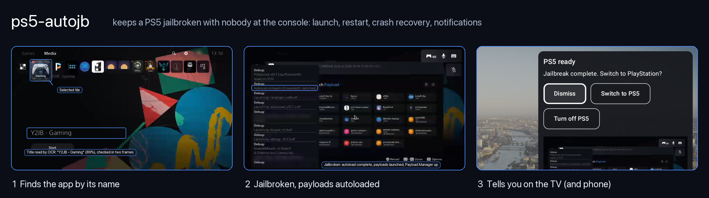
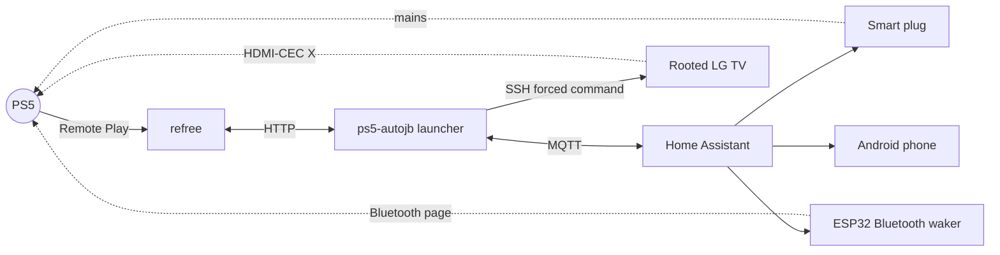
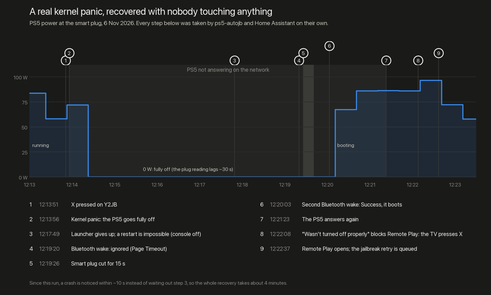
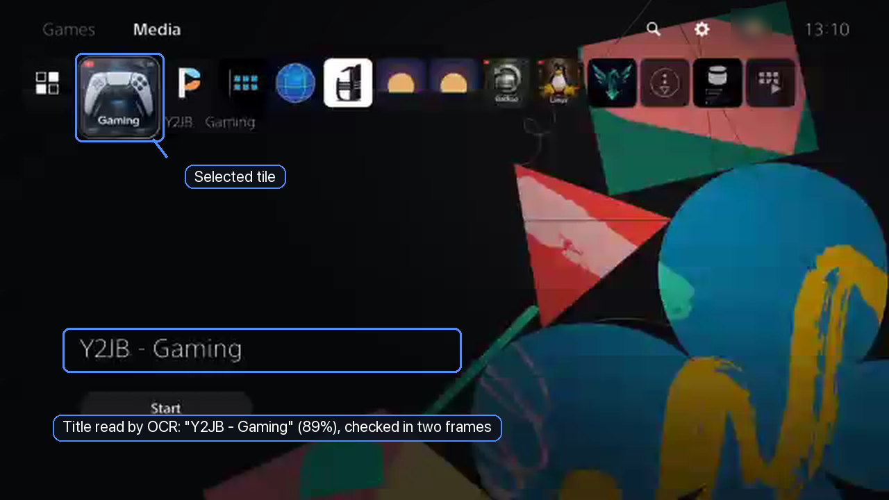
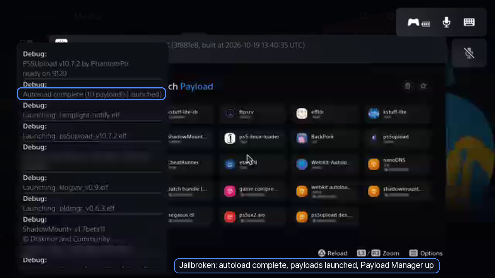
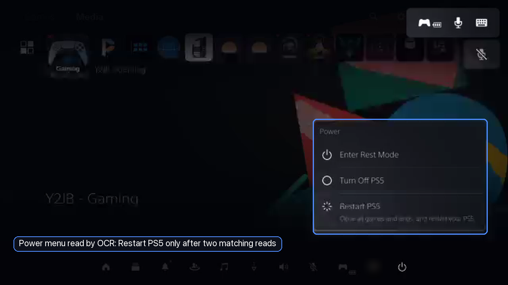
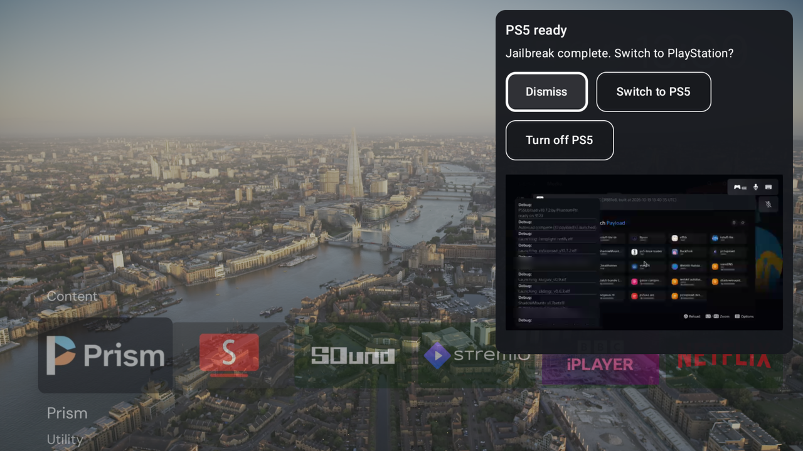
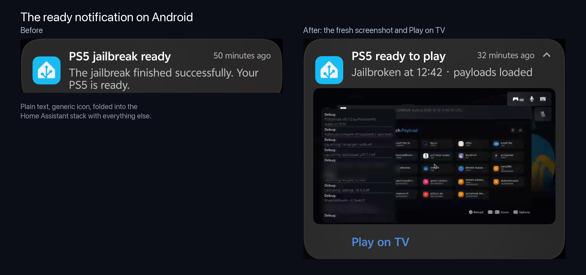

# ps5-autojb



Keep a jailbroken PS5 jailbroken with nobody at the console. When it boots, the target app (for example **Y2JB**)
is launched through Remote Play. When a launch fails or the console crashes, it's brought back: a verified restart,
then a Bluetooth wake or a smart-plug power cycle, then **X pressed by the TV** on the "wasn't turned off properly"
screen. Every step is reported to your Android phone through Home Assistant.

It's built on [refree](https://gitlab.com/refree/refree), which does the Remote Play part. This repo adds the
launcher, the recovery, and the Home Assistant, ESPHome and TV pieces around it. It contains **no exploit code or
payloads**: it only opens an app you already have, on a console you own.



## What happens

| Situation | What it does |
|---|---|
| The console boots (or wakes) | After 30 s on Home, opens Media, finds the target tile **by its on-screen name** (OCR, two matching frames), presses X once, and waits for the jailbreak's port. Phone: "PS5 jailbreak ready" with a fresh screenshot. |
| The app opened but the jailbreak didn't confirm | One **verified** restart: Power menu read by OCR, "Restart PS5" selected only after two matching reads. Then one more attempt. |
| The console crashed off (no reply, under 2 W) | Bluetooth wake. If it's ignored (common after a crash), cycle the plug for 15 s and wake again. |
| The console hung (no reply, over 30 W, more than 3 minutes) | One plug cycle (at most once a day), then wake. |
| Rest mode, or standby-level power | Bluetooth wake only. **Never a power cut.** |
| "Wasn't turned off properly" after a recovery | The TV presses X over HDMI-CEC (up to twice), whatever input it's showing. Otherwise your phone asks you to. |
| Anything unclear (unknown screen, other app, busy Remote Play, unreadable menu) | Stops without input and tells you. |

Limits survive restarts: three launched failures in 30 minutes, one restart per 30 minutes, power recovery once in two
hours, a hung console's power cut once a day. Turning **Automatic jailbreak** off cancels everything in progress.

## Proven live



On the author's setup (PS5 + Y2JB, Tapo P110 plug, ESP-WROOM-32, LG C1):
- **A real kernel panic recovered end to end, with no one touching anything.** Six seconds after X the console went
  fully off. The Bluetooth wake was ignored, the plug cycled, a second wake booted it to the warning screen, the TV
  pressed X, Remote Play opened and the retry was queued.
- About **one jailbreak attempt in three panicked** during repeated cycles; a clean cycle (shutdown, Bluetooth wake,
  jailbreak) takes about 3.5 minutes.
- What went wrong on the way is in [docs/how-it-works.md](docs/how-it-works.md#lessons-from-live-testing).

## What it looks like

All PS5 frames are real Remote Play captures from the launcher's own session (640×360, shown at 2×).

<table>
<tr>
<td width="50%"></td>
<td width="50%"></td>
</tr>
<tr>
<td><b>Finding the app.</b> The launcher opens Media and walks the row until the title under the tiles reads exactly
<code>target_name</code>, in two frames 0.8 s apart. Only then does it press X, once.</td>
<td><b>Jailbroken.</b> Y2JB's autoloader has launched its payloads and Payload Manager is up. This frame is the
picture attached to the "ready" notification.</td>
</tr>
<tr>
<td></td>
<td></td>
</tr>
<tr>
<td><b>The verified restart.</b> The selected row of the Power menu is read by OCR twice before Restart PS5 is pressed.
Anything unclear stops it without a press.</td>
<td><b>On the TV.</b> A card over whatever's playing, with the fresh screenshot, <i>Switch to PS5</i> and
<i>Turn off PS5</i> (Shield + QuickBars in the author's setup; the package's TV hook is yours to wire).</td>
</tr>
</table>



## Run paths: launch anything, not just the jailbreak

`paths.json` (next to refree's config) holds named step lists. Each one becomes a Home Assistant button, with a phone
message per step. The built-in steps:

| Step | Does |
|---|---|
| `fresh_boot` | A verified restart if the console is jailbroken (rest mode keeps the jailbreak, so a rested console isn't fresh). |
| `open` | Opens a tile **by its on-screen name**, wherever the Media row has moved it. Two frames must agree; nothing is pressed otherwise. |
| `wait` | For a console state (`rest`, `awake`, `offline`), a TCP port, a number of seconds, or the plug drawing more than N W. |
| `press_ps` | Presses PS with the ESP32 Bluetooth waker: wakes the console as its controller. |
| `press` | Plain buttons, for whatever comes after. |

The worked example, **Boot Linux** with Y2JB Linux ([`launcher/paths.example.json`](launcher/paths.example.json)), proven
live:

```json
{"linux": {"button": "Boot Linux", "steps": [
  {"fresh_boot": {}},
  {"open": {"tile": "Y2JB - Linux"}},
  {"wait": {"console": "rest", "timeout": 120}},
  {"wait": {"seconds": 45}},
  {"press_ps": {}},
  {"wait": {"console": "offline", "timeout": 60}},
  {"wait": {"watts_above": 100, "timeout": 120}}]}}
```

Y2JB Linux puts the console into rest by itself about 28 s after it opens. A PS press too early (16 s into rest) was
ignored and the console went back to rest; 45 s worked every time. Linux then reaches its login prompt about 20 s
after the press, at about 150 W, with the PS5's own network discovery silent. Whether SSH answers depends on the
distro, so the path ends on the power reading.

**Discover titles** (a button) walks the Media row with arrows only and records how OCR reads every tile. Those
readings count as the tile's name: the system font's J reads as I or `)`, so "Y2JB - Linux" arrives as "Y2IB - Linux",
and that's still recognised. **Not on Home?** It presses back at most twice, each followed by Home, before refusing.

## Parts

| Folder | What | Runs on |
|---|---|---|
| [`launcher/`](launcher/) | The service: launch, restart, power recovery, MQTT discovery | Any Linux box next to refree (Python 3, Tesseract) |
| [`homeassistant/`](homeassistant/) | One package: Android notifications with a Run button, the recovery power steps, full shutdown | Home Assistant |
| [`esphome/`](esphome/) | How to build refree's Bluetooth waker, and read the addresses it needs | An original ESP32 |
| [`tv/`](tv/) | The CEC X press | A rooted LG webOS TV (optional) |
| [`tools/`](tools/) | `read_dualsense.py`: the controller's and console's Bluetooth addresses | Linux, once |

## Setup

1. **refree** working: paired with the console, MQTT login, and the web API on port 8091.
2. **Launcher:** copy `launcher/ps5_autojb.py` to `/opt/ps5-autojb/`. It reads refree's `config.json` (console host,
   MQTT login). Put `autojb.json` next to it (start from [`autojb.example.json`](launcher/autojb.example.json)), then
   install [`systemd/ps5-autojb.service`](systemd/ps5-autojb.service). Dependencies: `python3-pil python3-paho-mqtt
   tesseract-ocr-eng`. Try `--focus-only` first: it finds and highlights the tile without opening it.
3. **Home Assistant:** add [`homeassistant/ps5_autojb.yaml`](homeassistant/ps5_autojb.yaml) as a package and set
   your phone's notify service in `script.ps5_autojb_notify`. The launcher's entities appear by themselves.
4. **Power recovery (optional):** a smart plug with power monitoring on the PS5 only (`switch.ps5_power_plug`,
   `sensor.ps5_power_plug_current_power`), and [the Bluetooth waker](esphome/README.md). Without them a crash is
   reported, not recovered.
5. **TV X press (optional):** [tv/README.md](tv/README.md).

## Configuration (`autojb.json`)

| Key | Default | Meaning |
|---|---|---|
| `target_name` | `Y2JB - Gaming` | The tile to open, exactly as its title reads on screen. Matching ignores case, spaces and dashes; anything else is refused. |
| `mqtt_prefix` | `ps5_autojb` | MQTT topic prefix. Change the package's topics to match. |
| `max_tiles` | `24` | How far along the Media row to look. |
| `remote_play_url` | `http://127.0.0.1:8091` | refree's web API. |
| `public_url` | refree's URL | How Home Assistant (and your phone) reach the ready screenshot. |
| `tv_host` | empty (off) | The rooted TV for the CEC X press. |
| `off_watts`, `hung_watts` | `2.0`, `30.0` | Plug readings for "fully off" and "running or hung". Rest mode sits between them and is never power-cut. |

Unknown keys are refused, so a typo can't silently keep a default.

## Known limitations

- **The TV's X is blind.** The launcher can't see the warning screen, so it only presses after its own recovery, when
  Remote Play is refused and not busy.
- **A manual run that panics isn't recovered automatically**; only automatic passes are.
- **Paths don't recover.** A path stops at the first unclear step and tells you; only the automatic jailbreak runs the crash recovery.
- Tested on one setup: PS5 with Y2JB, Tapo P110, ESP-WROOM-32, LG C1, Shield. Menu positions and OCR boxes assume the
  PS5's English UI at Remote Play's 640×360.

## Tests

```sh
pip install pytest pillow pyyaml
pytest tests                                   # launcher, recovery, settings, TV script, package consistency
cd tests/homeassistant && pytest               # optional: renders the package in a real test Home Assistant
```

## Credits

- [refree](https://gitlab.com/refree/refree) (AGPL-3.0): Remote Play control, and the `bt-waker` ESPHome firmware.
- [wakepsx-on-bt](https://github.com/FreeTHX/wakepsx-on-bt) (MIT): the Bluetooth wake technique.
- [chiaki](https://git.sr.ht/~thestr4ng3r/chiaki): the Remote Play protocol that refree builds on.

MIT licence for this repo's own code ([LICENSE](LICENSE)).
