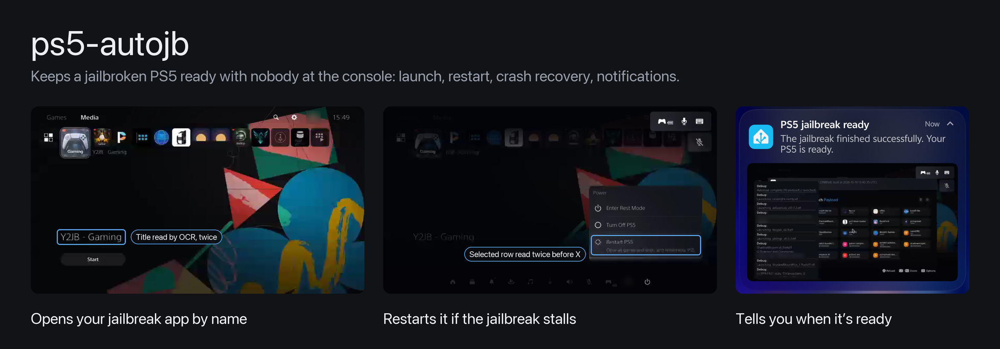
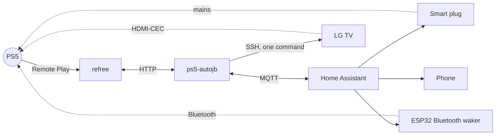
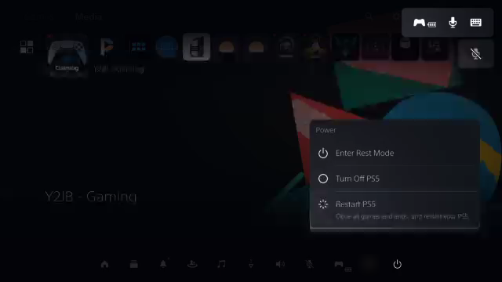
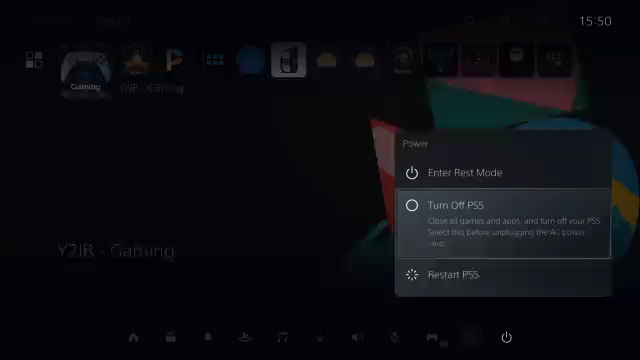
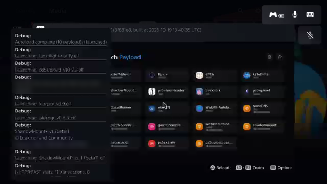
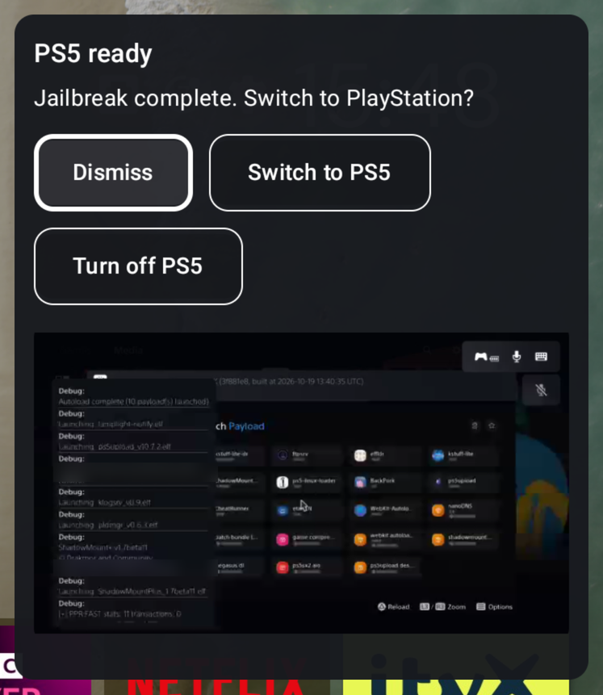

# ps5-autojb



Keeps a jailbroken PS5 ready without anyone at the console. When the PS5 boots, ps5-autojb opens your jailbreak app
over Remote Play, finding it by the name on screen rather than its position. If the jailbreak crashes the console, it
brings it back: a Bluetooth wake, a smart-plug power cycle if needed, and an X press from the TV over HDMI-CEC to clear
"Your PS5 wasn't turned off properly". Home Assistant shows each step and sends it to your phone.

It also runs configurable launch paths. The example is Boot Linux, which needs a fresh boot, the Y2JB Linux app, a
wait for rest mode, and a PS button press. All of that runs from one button.

It is built on [refree](https://gitlab.com/refree/refree), which handles Remote Play. There is no exploit code or
payload in this repo; it opens apps that are already on your console.

## What it does

- **Launch by name.** Opens the Media tab and reads each tile's title with OCR. It presses X only when two frames read
  the configured name. The Media row reorders by recent use, so positions aren't reliable.
- **Restart a stuck jailbreak.** If the app opens but the jailbreak doesn't confirm, it opens the Power menu, reads the
  selected row twice, and selects Restart PS5. Anything it can't read stops it without a press.
- **Recover a crash.** If the console goes silent: under 2 W at the plug it's off, so it sends a Bluetooth wake and, if
  that's ignored, cycles the plug for 15 seconds and wakes again. Over 30 W and silent for three minutes, it treats the
  console as hung and cycles the plug, at most once a day. In rest mode it never cuts power.
- **Clear the warning screen.** After a power cut the PS5 waits for X on "Your PS5 wasn't turned off properly", and
  Remote Play doesn't work until then. A rooted LG TV sends X over HDMI-CEC, whatever input it's showing.
- **Run paths.** Named step lists in `paths.json`, each a Home Assistant button. See [Run paths](#run-paths).
- **Tell you.** Each step is a phone notification; the ready one has a screenshot of the console.

Limits survive restarts: three failed launches in 30 minutes, one restart per 30 minutes, power recovery once in two
hours. Turning off Automatic jailbreak cancels anything in progress.

A crash it recovered on 6 November, from the plug's power readings and the launcher's log:


## Parts

| Folder | What | Runs on |
|---|---|---|
| [`launcher/`](launcher/) | The service: launch, restart, recovery, paths, MQTT | A Linux machine next to refree (Python 3, Tesseract) |
| [`homeassistant/`](homeassistant/) | Package: notifications, the recovery power steps, full shutdown | Home Assistant |
| [`esphome/`](esphome/) | Building refree's Bluetooth waker, and reading the addresses it needs | An original ESP32 |
| [`tv/`](tv/) | The HDMI-CEC X press | A rooted LG webOS TV (optional) |
| [`tools/`](tools/) | `read_dualsense.py`: the controller's and console's Bluetooth addresses | Linux, once |



## Setup

[docs/setup.md](docs/setup.md) goes through it in order, with a check after each step. In short:

1. refree paired with the console, with MQTT and its web API on port 8091.
2. The launcher next to refree, with `autojb.json` and optionally `paths.json`, run by systemd.
3. The Home Assistant package, with your phone's notify service set.
4. Optional: a smart plug with power monitoring on the PS5 and the ESP32 waker, for crash recovery.
5. Optional: a rooted LG TV for the X press.

If you're setting this up with an AI assistant, point it at [llms.txt](llms.txt).

## Run paths

`paths.json` next to refree's config holds named lists of steps. Each path becomes a Home Assistant button.

| Step | What it does |
|---|---|
| `fresh_boot` | Restarts the console (through the checked Power menu) if it's jailbroken. Rest mode keeps the jailbreak, so a rested console isn't fresh. |
| `open` | Opens a tile by name. |
| `wait` | Waits for a console state (`rest`, `awake`, `offline`), a TCP port, a number of seconds, or the plug drawing more than N watts. |
| `press_ps` | Presses PS through the Bluetooth waker. |
| `press` | Presses buttons. |

Boot Linux ([`launcher/paths.example.json`](launcher/paths.example.json)):

```json
{"linux": {"button": "Boot Linux", "steps": [
  {"fresh_boot": {}},
  {"open": {"tile": "Y2JB - Linux"}},
  {"wait": {"console": "rest", "timeout": 120}},
  {"wait": {"seconds": 45}},
  {"press_ps": {}},
  {"wait": {"console": "offline", "timeout": 60}},
  {"wait": {"watts_above": 100, "timeout": 120}}]}}
```

Y2JB Linux puts the console into rest about 28 seconds after it opens. Pressing PS 16 seconds into rest didn't work;
45 seconds did. Linux reaches its login prompt about 20 seconds after the press, drawing about 150 W, and the PS5 stops
answering discovery. SSH isn't always up by then, so the path checks power instead.

The Discover titles button walks the Media row (arrow keys only) and stores how OCR reads each tile. Those readings
count as the tile's name, which matters because this font's J often reads as I or `)`.

## Screens it works with

| | |
|---|---|
|  |  |
| The title under the row is what OCR reads. | Restart PS5 selected. There's no outline here: only the description line under it shows the selection. |
|  |  |
| Turn Off PS5 selected, for a full shutdown. | After the jailbreak. This frame is the picture in the notification. |

These are Remote Play frames at their real size, 640×360.



The ready message on the TV here: an NVIDIA Shield overlay that's part of the author's own Home Assistant setup, not
this repo. The package calls `script.ps5_autojb_tv_notice` with a title, a message and the picture's URL, for you to send to
whatever your TV shows ([docs/notifications.md](docs/notifications.md#on-the-tv)).

## Limitations

- Tested on one setup: PS5 with Y2JB, Tapo P110 plug, ESP-WROOM-32, LG C1, NVIDIA Shield, Android phone. The OCR crops
  assume the PS5's English UI.
- The TV's X press is blind. It only happens after the launcher's own recovery, when Remote Play is refused and not busy.
- Paths stop at the first step that fails; they don't run the crash recovery. Neither do manual launches.
- refree segfaulted when a Remote Play session was open while an app started. The launcher always closes the session
  straight after pressing X. Details in [docs/upstream/refree-issues.md](docs/upstream/refree-issues.md).

## More

- [docs/home-assistant.md](docs/home-assistant.md): every entity, the package, and a dashboard card.
- [docs/how-it-works.md](docs/how-it-works.md): the launch, the recovery, the limits, and what went wrong while testing.
- [docs/notifications.md](docs/notifications.md): every notification and button.

## Tests

```sh
pip install pytest pillow pyyaml
pytest tests
cd tests/homeassistant && pytest    # optional, needs pytest-homeassistant-custom-component
```

## Credits

- [refree](https://gitlab.com/refree/refree) (AGPL-3.0): Remote Play control and the `bt-waker` firmware.
- [wakepsx-on-bt](https://github.com/FreeTHX/wakepsx-on-bt) (MIT): the Bluetooth wake.
- [chiaki](https://git.sr.ht/~thestr4ng3r/chiaki): the Remote Play protocol refree uses.

This repo's code is MIT licensed ([LICENSE](LICENSE)).
